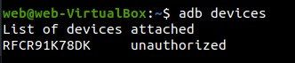
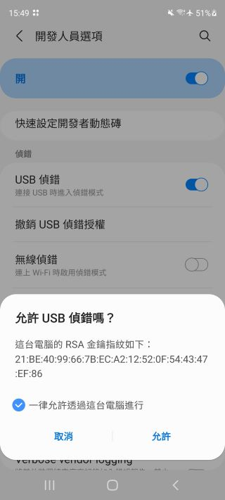
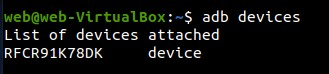
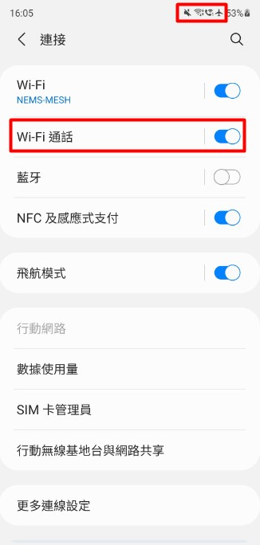

# Wi-Fi Calling native probe

This directory contains the native `spoof` executable, carrier configurations, and tests. The entry point is `standalone/source/main.cpp`; `all/CMakeLists.txt` builds `bin/spoof`.

Run the computer-side commands below from the **directory containing this README**. Phone-side commands are marked separately. Startup behavior and defaults were checked against the source on **2026-11-02**.

## 1. Environment Setup

### 1.1 Requirements

- Computer: Android NDK, CMake >= 3.24 and dependency access/cache for CPM (Crypto++, mbedTLS, curl, nlohmann/json and cxxopts). CMake configures C++20.
- Phone: root, a compatible SIM and working Wi-Fi Calling. This implementation assumes `wlan0`, an `epdg0`–`epdg9` interface and carrier properties described below; root alone does not establish compatibility.
- ADB is sufficient for manual startup; Termux is optional.

## 2. Build

### 2.1 Adjust Config for Android Toolchain
Set the installed NDK directory:

```bash
export NDK="$HOME/android-ndk-r25"
cmake -S all -B build \
  -D "CMAKE_TOOLCHAIN_FILE=$NDK/build/cmake/android.toolchain.cmake" \
  -D ANDROID_PLATFORM=android-29 \
  -D ANDROID_ABI=armeabi-v7a \
  -D CMAKE_BUILD_TYPE=Release
```

### 2.2 Build Binary
```bash
cmake --build build --config Release --parallel 2
```

Output: `bin/spoof`. Use a separate build directory for another ABI.

### 2.3 Run Host Tests

Use a separate host build directory without the Android toolchain:

```bash
cmake -S tests -B build-tests
cmake --build build-tests
ctest --test-dir build-tests --output-on-failure
```

These tests require a C++20-capable host compiler and exercise the event contract, SIP parser, response state machine, watchdog policy, mode selection and capture writer without sending network traffic.

### 2.4 Probe Runtime Boundaries

- `ProbeController` owns the continuous probe loop and executes retry/watchdog decisions.
- `probe_state_machine` converts SIP response status and retry context into ordered state transitions.
- `sip_response` parses SIP identifiers, response metadata, and cellular information.
- `Session` owns packet/ESP transport, monotonic latency timestamps, and structured event emission.
- `NativeRunMode` resolves CLI flags to one deterministic mode using the previous precedence order.
- `application.cpp` contains the active probe integration; `legacy_application.cpp` contains CLI-only workflows.

## 3. Install

### 3.1 Connect Device
- Open the developer options, and allow the USB debugging
- Use the adb command to check if the device is connected to the computer

```bash
adb devices
```





- Use the adb command to check the authorization
```bash
adb devices
```


### 3.2 Push Binary

On the computer, from the directory containing this README:

```bash
adb push bin/spoof /data/local/tmp/spoof
adb push config /data/local/tmp/
adb shell
```

With multiple phones connected, use `adb -s <serial>` for the intended device. The following `su` / native commands are run **inside the phone shell**, not on the computer.


## 4. Usage
### 4.1 Wi-Fi Calling startup

Enable and verify Wi-Fi Calling on the **probing phone** beforehand. Native startup itself:

1. Reads `victim_list` (or creates it with interactive `-e`).
2. Reads `sys.smf.mnoname` properties containing `LOADED` to select `config/<carrier>`. Supplied folders are CHT, FET and TWM.
3. Sets airplane mode, broadcasts the change, waits five seconds, then enables Wi-Fi.
4. Waits for `wlan0` and an `epdg0`–`epdg9` interface, obtains IMS/IPsec configuration from SADB, then waits for initial SIP traffic to obtain caller/signaling state.
5. Enters the selected mode.

The program does not separately check that VoLTE is disabled. A missing interface, unsupported carrier-property layout or missing IMS setup can prevent startup. It changes settings on the probing phone and does not automatically restore previous airplane/Wi-Fi settings on exit.




### 4.2 Remote Cell ID Prober

Inside the phone shell, after `adb shell`:

```sh
su
cd /data/local/tmp
chmod 700 spoof
printf '%s\n' '09XXXXXXXX' > victim_list
PROBE_INTERVAL_SECONDS=10 ./spoof -r --verbose 1 --session-progress-response-limit 1
```

Replace `09XXXXXXXX` with the actual authorized test number. The native code expects a local Taiwan number beginning with `0`, normally converting it to `+886...` (FET keeps the local format). Do not use an already-prefixed `+886...` entry in this workflow. Remote mode uses the first nonempty entry.

The working directory must contain both `victim_list` and `config/<carrier>/...`. The example selects a 10-second interval and a one-response limit. Stop the run with Ctrl+C; startup wait loops may not respond immediately.

### 4.3 CLI settings and defaults

| Setting | Behavior / default |
|---|---|
| `PROBE_INTERVAL_SECONDS` | Absent/invalid defaults to **30**. Accepted: 0, 5, 10, 20, 30, 60. Actual sends can be later. |
| `--session-progress-response-limit` | Default **0** uses carrier policy; accepted range 0–20. Set 1 explicitly for a one-response limit. |
| `--verbose` / `-v` | Default **1**. |
| `SIP_CAPTURE_PATH` | Unset/empty: capture disabled. Set a writable file path to enable native JSONL capture. |
| `SIP_CAPTURE_RUN_ID` | Optional capture label; defaults to `unknown`. |
| `GOOGLE_API_KEY` | Used by legacy geolocation helpers; not required for active `-r` timing/Cell output. |

Running `./spoof -r` uses the defaults above. The 10-second interval in the earlier example is an explicit setting.

To record native SIP data, set the capture variables on the phone:

```sh
SIP_CAPTURE_PATH=/data/local/tmp/sip_capture.jsonl \
SIP_CAPTURE_RUN_ID=manual-run \
PROBE_INTERVAL_SECONDS=10 \
./spoof -r --verbose 1 --session-progress-response-limit 1
```

The file contains raw JSONL records with timestamps, transport metadata and captured SIP content. Default limits are 16 MiB per file, eight files total and an 8 MiB writer queue. Configure them with `SIP_CAPTURE_MAX_BYTES`, `SIP_CAPTURE_MAX_FILES` and `SIP_CAPTURE_QUEUE_MAX_BYTES`. Files rotate to suffixes `.1` through `.7` at the default file count; queue overflow can drop records. Check `capture_summary` for recorded drop counts when assessing completeness.

### 4.4 Other CLI modes

| Flag | Actual behavior |
|---|---|
| `-l`, `--local-cellid-prober` | Legacy `LOCAL_SERVER`; starts a TCP command server on port 23456 and waits for an external controller. It does not read Android local serving-cell telemetry. |
| `-a`, `--rl-assisted-remote-cellid-prober` | Legacy adaptive command-server workflow; also waits for external commands and depends on older prediction/upload services. |
| `-u`, `--unavailability-eval` | Legacy unavailability evaluation. |
| `-d`, `--detect-eval` | Legacy detection evaluation. |
| `-e`, `--enable-input` | Interactive number entry, saved to `victim_list`; combine with an explicit mode. |
| `-h`, `--help` | Prints options and exits before device setup. |

Select one mode explicitly. Multiple mode flags use priority `-r`, `-l`, `-a`, `-u`, `-d`. Without a mode, the code still performs device setup but has no selected probe workflow; the old no-argument help example does not provide local-cell sampling.
